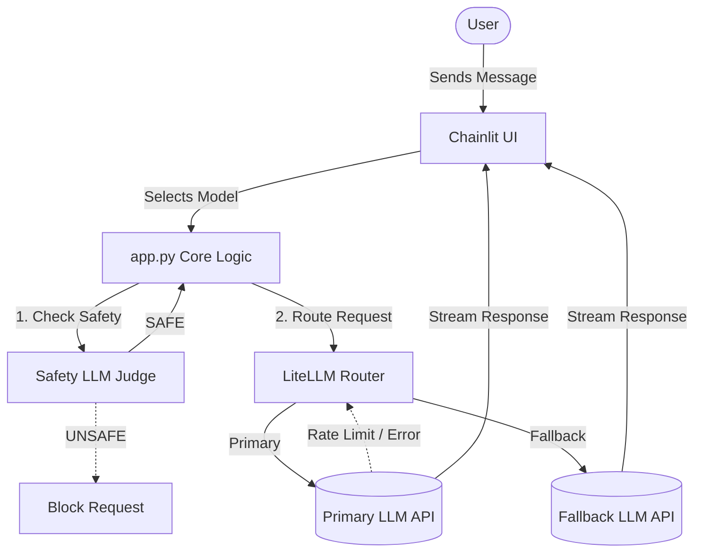

# AI-Powered Chatbot

A flexible, scalable AI chatbot application, this project allows users to interact with multiple Large Language Models (LLMs), featuring real-time streaming, built-in safety guardrails, and robust error handling.

## Features

* **Multi-Model Support**: Easily switch between top-tier open-source models (GPT-OSS, Gemma, etc.) via the UI.
* **Smart Error Handling**: Automatically detects API token limits or service outages and seamlessly routes the request to a reliable fallback model.
* **Safety Guardrails**: Analyzes user input to prevent the bot from assisting with unsafe or unethical requests.
* **Real-time Streaming**: Provides a fast, interactive experience by streaming token responses.
* **Flexible Architecture**: Built with `Chainlit` and `LiteLLM`, allowing new models and providers to be added with minimal code changes.

## Tech Stack

* **Frontend/UI**: [Chainlit](https://chainlit.io/) - A powerful framework for creating chat interfaces.
* **LLM Orchestration**: [LiteLLM](https://litellm.vercel.app/) - A unified interface to call 100+ LLM APIs using the OpenAI format.
* **Providers**: Gemini, Groq and OpenRouter (for a wide variety of open-source models).
* **Environment Management**: `python-dotenv` for secure API key handling.

## Architecture



## Setup & Run Locally

Follow these steps to run the chatbot on your local machine:

1. **Clone the repository**
   ```bash
   git clone <your-repo-url>
   cd Chatbot
   ```

2. **Set up a Virtual Environment (Recommended)**
   ```bash
   python -m venv venv
   # On Windows:
   venv\Scripts\activate
   # On macOS/Linux:
   source venv/bin/activate
   ```

3. **Install Dependencies**
   ```bash
   pip install -r requirements.txt
   ```

4. **Configure Environment Variables**
   * Copy the `.env.example` file and rename it to `.env`.
   * Add your API keys to the `.env` file.
   ```bash
   cp .env.example .env
   ```

5. **Run the Application**
   ```bash
   chainlit run app.py -w
   ```
   *The `-w` flag enables auto-reloading if you make code changes.*